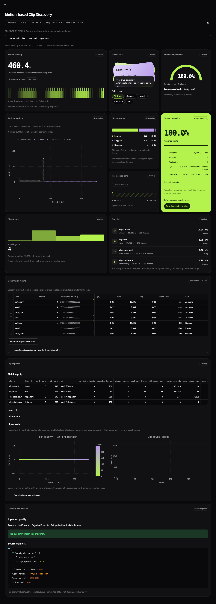
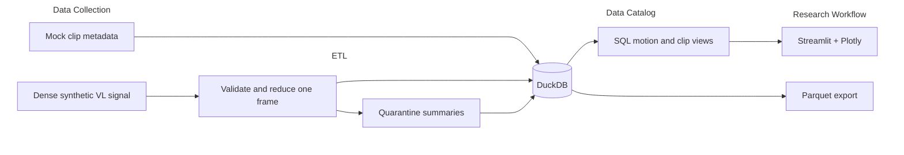

# README.md

Find recorded-drive clips by ego motion(EM), inspect their trajectories, and trace every result back to its source frame. This motion-based clip discovery turns dense vehicle-location(VL) point clouds into a reusable SQL catalog and an interactive dashboard UI.

## What comes out of the pipeline

The default run creates `data/catalog.duckdb` with **1,000 accepted frame records and four clip summaries**, one for each synthetic drive: steady, turn, stop/start and stationary. The command prints an ingestion report; the dashboard reads the database and lets you find and inspect those clips. You can download result tables as CSV or export reduced frame facts as Parquet.

Each source frame contains one million XYZ points. The ETL keeps its centroid, bounds, point count and lineage, then releases the dense array. SQL compares adjacent frames to derive speed and stopped time. The default replay processes one billion points without holding them all in memory.

For example, moving the mock cube by one meter between frames at 16 FPS produces a speed of 16 m/s. The first frame has no predecessor, so its speed is unknown. The default motion distribution is 622 Moving, 374 Stopped and 4 Unknown observations. These are calculated motion states, not detected incidents.

[Run locally](#quick-start) · [Explore the dashboard](#use-it) · [Understand the architecture](#architecture)

## Run locally

Prerequisites: Python 3.11-3.13 and [uv](https://docs.astral.sh/uv/getting-started/installation/). The verified environment uses Python 3.12 on macOS ARM64. Run from the repository root. Installation needs internet access; normal demo use does not.

```sh
uv sync --locked --python 3.12
uv run vl-demo
uv run streamlit run app.py
```

Without an existing default catalog or a `VL_DATABASE` override, the dashboard automatically builds an isolated synthetic demo. An explicitly configured missing database still reports an error.

Open [the local dashboard](http://127.0.0.1:8501). The default pipeline generates four drives × 250 frames × 1,000,000 points: one billion points processed without retaining all clouds. Timestamps represent 16 FPS; generation runs as accelerated replay.

For a quick small fixture in a separate database:

```sh
uv run vl-demo --frames-per-drive 16 --side-cm 2 --database data/small.duckdb
VL_DATABASE=data/small.duckdb uv run streamlit run app.py
```

Stop the dashboard before rebuilding its database. DuckDB supports a read/write process or multiple read-only processes; this demo does not coordinate concurrent ingestion and BI. Rerunning `vl-demo` atomically publishes a new current catalog and retains three successful runs by default (`--retention`). Unrecognized databases are refused.

## Use it

1. Choose a drive, speed threshold and minimum accumulated duration, stopped-interval filter, or search clip/drive IDs in the sidebar.
2. Expand **Observation filters** to choose a frame window, motion state or local X/Y bounds. Counts and time bins cover all matches; the plot/table preview is capped at 5,000 rows.
3. Select a position point or table row to inspect its exact warehouse record. The row-index control is a keyboard alternative. Sort/search the native table and export displayed observations as CSV.
4. Download matching clips from **Snapshot quality**, or scroll to **Clip explorer** for a clip's XY trajectory, speed and source lineage.
5. Scroll to **Quality & provenance** for rejected inputs, duplicate/missing-frame warnings and the source manifest.

The dashboard adapts the supplied **Web3Bento** visual reference using native Streamlit, Plotly and CSS. Each tile labels its Catalog, Observation or Whole snapshot scope. See the [Bento verification report](docs/bento_verification.md) for data checks and before/after screenshots.



Stopped means speed ≤0.5 m/s over a valid adjacent-frame interval. First frames and frames following a gap have unknown speed. Observed duration and distance exclude unknown intervals. Mock clip URIs are catalog identifiers, not playable videos. The default source has no injected defects; the tests exercise quarantine and recovery.

The top-bar theme switch retains catalog and observation filters. Drive pills and the sidebar Drive control select the same catalog scope. Restart Streamlit after changing theme configuration.

## Architecture



**How this maps to the proposal:** VL frames pass through ETL, while clip metadata supplies the drive IDs and frame ranges used to connect motion to clips. Both enter the same catalog transaction. The dashboard queries this catalog; it does not calculate a second set of motion metrics.

**Failure path:** if quality gates fail or ingestion is interrupted, the snapshot rolls back and the previous catalog remains available. Failed attempts have a separate audit record. Quality records retain rejection summaries, not the rejected point clouds.

The source currently generates synthetic frames and mock clip references. It does not collect real sensor data or store video. Dense clouds are released after reduction; the warehouse retains compact facts and lineage. See the [interactive architecture diagrams](docs/diagrams/README.md) for a deeper walkthrough.

- Source: Python/NumPy produces the full centimeter grid and deterministic translations. Alternative durable Parquet sources suit real archives; API/Kafka ingestion suits independent live producers.
- ETL: NumPy reduces one frame at a time; Python validates contracts and SQL handles temporal calculations. Polars/Arrow suit broader columnar transformations; Spark suits independent drives exceeding one host's measured capacity.
- Warehouse: DuckDB supplies local analytical SQL and transactions. PostgreSQL suits shared mutable catalogs; Iceberg with object storage and distributed compute suits large multi-engine archives. Parquet is a file format, not a transactional table system.
- BI: Streamlit and Plotly provide researcher filters and drill-down. React/FastAPI offers more custom product control; Metabase suits governed shared reporting.

Follow one record through the code:

| Step | Code | What happens and why |
|---|---|---|
| 1. Generate | [`source.py`](src/vl_product/source.py) | Yield a dense cloud and frame metadata; keep memory bounded to the current frame. |
| 2. Validate and reduce | [`etl.py`](src/vl_product/etl.py) | Check units, shape and clock; convert centimeters to meters and retain compact facts plus a content hash. |
| 3. Store | [`warehouse.py`](src/vl_product/warehouse.py) | Insert accepted facts and quality records in one transaction; preserve the previous snapshot if ingestion fails. |
| 4. Calculate | [`schema.sql`](src/vl_product/schema.sql) | Derive motion and clip summaries in reusable SQL views. |
| 5. Explore | [`exploration.py`](src/vl_product/exploration.py), [`app.py`](app.py) | Query filtered warehouse facts, then render charts and exact-record drill-down. |

The [catalog reference](docs/catalog_reference.md) documents table grains, timestamp and duplicate rules, SQL examples, exports and error recovery.

No broker, scheduler, cloud account or Docker daemon is required. The locked environment is the local deployment unit. Production extensions and replacement triggers are documented in [the architecture](docs/architecture.md).

## Verification

```sh
uv run pytest -q
uv run ruff check .
uv run ruff format --check .
uv run python scripts/benchmark.py
uv run pip-audit
uv build
```

Tests cover source density/cadence, schema and coordinate validation, units, hashing, duplicates/conflicts, shuffled/gapped frames, three-axis speed, stop/turn scenarios, replay, transactional rollback, export safety, CLI and dashboard interactions. Explicit benchmark checks enforce the documented local targets. The dependency audit needs internet access and excludes the unpublished local package from vulnerability matching.

The original dense benchmark measured **12.003 seconds**, **246.672 MiB peak RSS**, and a **6.473 ms** clip-summary query including connection setup. That historical measurement is separate from the current dashboard and hosting checks documented in [the delivery notes](docs/premium_bi_delivery.md).

Actual results, browser checks, warnings and reproducibility evidence are recorded in [docs/verification_report.md](docs/verification_report.md). Do not interpret a local benchmark as a production SLA.

## Error codes and recovery

| Code | Meaning / action |
|---|---|
| `E_CATALOG` | Invalid drive/clip catalog; correct metadata before retrying |
| `E_QUALITY_GATE` | Catalog failed acceptance thresholds; previous catalog is preserved (CLI exit 4) |
| `E_CONFIG` | Invalid frame count or cube size; use 1-100,000 frames/drive and 1-100 cm cube side |
| `E_SCHEMA` | Wrong envelope or source version; supply a version 1 `Frame` |
| `E_UNITS` | Coordinates are not declared in centimeters |
| `E_COORDINATE_SYSTEM` | Source does not declare `local_world` |
| `E_METADATA` | Invalid drive/index or frame outside declared catalog |
| `E_TIMESTAMP` | Timestamp does not match the declared drive clock |
| `E_SHAPE` | Cloud is not an N×3 array with 1-1,000,000 points |
| `E_COORDINATES` | Nonnumeric, nonfinite, fractional-centimeter or out-of-range coordinates |
| `E_DUPLICATE_CONFLICT` | Same frame key, different content; investigate source version/order |
| `W_DUPLICATE` | Identical frame skipped; no additional fact inserted |
| `W_MISSING_FRAMES` | Clip has fewer accepted frames than its declared interval |
| `E_DATABASE` | Unrecognized/unsupported warehouse; choose a fresh path or explicit migration |
| `E_EXPORT` | Export target already exists or is the database; choose a new filename |
| `E_STORAGE` | File, database or lock failure; inspect permissions, disk and active processes |

CLI exit 0 means the generated pipeline completed, 2 means configuration/path validation or argument usage failed, and 3 means storage/export I/O failed. Library callers receive unexpected iterator/programming exceptions after rollback; they must retry or correct the source. There is no silent catch-all retry loop.

## Known limitations

Clip ranking uses accumulated time at or above a threshold, then 90th-percentile speed.
Intervals can be separated; this is not a continuous-motion detector. Both thresholds
at zero include unknown-speed clips; a positive speed requires a qualifying interval,
and a positive duration requires that much observed time. Peak speed remains visible.
At 16 FPS a 1 m centroid jump produces 16 m/s; even about 3.1 cm per frame approaches
the default stop threshold. Real clouds need calibrated pose and noise treatment.

- Synthetic rigid geometry, shared local coordinates and an exact clock do not represent real sensor noise, rotations, partial clouds or clock jitter. No accuracy or ML benefit is established.
- Single-host, full-snapshot ingestion with bounded run history; no per-drive incremental updates, live broker, multi-writer access or external raw retention.
- The default adapter supplies four mock scenarios. Other adapters implement FrameSource with independent drives, clips, manifest and frames.
- Hashing respects point order. Reordered points can have equal geometry but different hashes; the source contract preserves order.
- Dashboard frame preview is capped at 5,000 points and quality preview at 1,000 events; summaries/SQL cover the full catalog.
- Local use and a synthetic demo are supported. Application authentication and production access controls are not implemented; app.py initializes a synthetic catalog automatically when the default database is absent.
- DuckDB's DataFrame conversion emits a Pandas deprecation warning in the locked environment. Tests and browser checks pass; no warning is suppressed.
- Graphify indexed Python, but its optional SQL parser was absent. No real-world infrastructure validation or formal accessibility audit is claimed.

## Next version release notes - planned, not shipped

### Product Description

A calibrated, versioned clip catalog for recorded-drive archives.

### Usage Documentation / Example

Researchers would ingest a real drive manifest, filter clips by motion, then open authorized footage through the clip catalog.

Current runnable example (synthetic data):

```sh
uv run vl-demo --frames-per-drive 16 --side-cm 2 --database data/example.duckdb
```

Expected output: 64 accepted frames, zero rejections and zero duplicates. Real-drive ingestion and footage access remain planned.

### Known Issues

- Mock centroid motion cannot validate real localization accuracy.
- Full rebuilds limit freshness; bounded retention limits durable historical comparisons.
- Quarantine summaries cannot reconstruct malformed raw inputs.

### Coming Soon

- Retain raw objects and durable links from each fact to its source.
- Ingest calibrated poses and version each drive incrementally.
- Connect real clip references and add authenticated shared BI.
- Adopt distributed processing when measured workloads exceed one host's capacity.

## LLM Usage Disclosure

Work was assisted using Codex GPT-6 Astra model for planning/implementation and Claude Opus 5.5 for reviewing.

Used Skills/MCPs/Repos sources could be found in [AGENTS.md](AGENTS.md)
